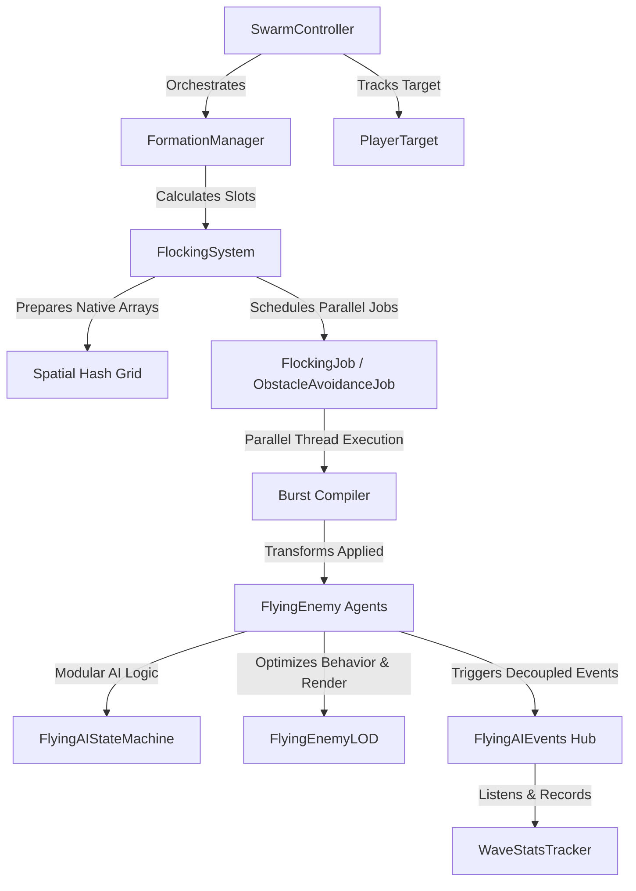

<p align="center">
  
</p>

<h1 align="center">🛸 High-Performance Flying AI Swarm System</h1>
[](https://unity.com/)
[](https://docs.microsoft.com/en-us/dotnet/csharp/)
[](#performance-optimization)
[](LICENSE)

A production-grade, highly-optimized **3D Swarm Intelligence and Formation Navigation System** built for Unity. By leveraging the **C# Job System**, the **Burst Compiler**, and a custom **Spatial Hashing Grid**, this framework schedules and executes flocking behaviors, collision avoidance, and tactical formations in parallel across worker threads, maintaining a smooth **60+ FPS with hundreds of active agents**.

Designed as a modular, decoupled framework, it represents an industry-standard implementation of scalable agent AI suitable for flight simulators, space shooters, sci-fi RTS, and action games.

---


<p align="center"><a href="#architectural-overview">🏗️ Architectural Overview</a> &nbsp;·&nbsp; <a href="#key-features">🌟 Key Features</a> &nbsp;·&nbsp; <a href="#tech-stack-dependencies">🛠️ Tech Stack &amp; Dependencies</a> &nbsp;·&nbsp; <a href="#project-structure">📂 Project Structure</a></p>

## 🏗️ Architectural Overview

The system is built on a decoupled, event-driven architecture using high-performance Native Containers and parallel Job pipelines.



---

## 🌟 Key Features

### ⚡ 1. Parallel Flocking System (Jobs & Burst)
*   **Vectorized Calculations**: Computes classic Boids behaviors (Cohesion, Separation, Alignment) in parallel using `Unity.Mathematics` (`float3`) for maximum SIMD efficiency.
*   **Spatial Hashing Grid**: Replaces standard $O(N^2)$ distance checks with a custom $O(N)$ 3D Spatial Grid hashing, grouping agents by cell hash map (`NativeParallelHashMap`) to dramatically reduce neighbor-lookup cost.
*   **Dynamic Obstacle Avoidance**: Integrates jobified raycasting (`RaycastCommand`) to calculate dynamic steering corrections around static and moving obstacles in parallel.

### 📐 2. Dynamic Formation Steering
*   **Interface Segregation**: Formations are decoupled via the `IFormation` interface and created dynamically using the **Factory Pattern** (`FormationFactory`).
*   **Runtime Reconstitution**: Instantly calculates slot positioning for **V-Shape (Geese)**, **Circle (Surrounding)**, **Grid (Assault)**, **Diamond (Defense)**, and **Line (Pursuit)**.
*   **Dynamic Slot Healing**: Re-evaluates and fills slots automatically in real-time when squad members are destroyed.

### 🧠 3. Decoupled Finite State Machine (FSM)
*   **State Interface Design**: Agents utilize a modular State Pattern (`IStateMachine`, `IState`) managing behaviors including **Idle**, **Patrol**, **Chase**, **Attack**, **Evade (Advanced Evasion)**, and **Regroup**.
*   **Predictive Chase**: Intercepts moving targets using projectile velocity and target velocity vectors to calculate optimal leading intercept vectors.

### 🚀 4. Performance & Resource Optimization
*   **Zero GC Allocation**: Standard gameplay loop produces **0 bytes of Garbage Collector allocations** through custom object pooling (`ObjectPoolBase`) for both enemies and projectiles.
*   **Dynamic LOD System**: A distance-based Level of Detail (`FlyingEnemyLOD`) decreases physics calculations, state updates, and animation cycles for distant swarm agents.
*   **Zero-Overhead Logging**: A custom categorized logger (`DebugLogger`) utilizing `[Conditional]` compiler attributes, stripping all log footprints in release/production builds.

### 🛠️ 5. Custom Developer Tooling
*   **Unity Editor Log Manager**: An custom editor window (`LogManagerWindow`, shortcut `Ctrl+Shift+L`) featuring category filtering, colored console log outputs, and one-click clipboard exporters to capture diagnostic reports instantly.

---

## 🛠️ Tech Stack & Dependencies

*   **Unity Engine** (Recommended: 2022.3 LTS+)
*   **Unity C# Job System** (`com.unity.jobs`)
*   **Unity Burst Compiler** (`com.unity.burst`)
*   **Unity Mathematics** (`com.unity.mathematics`)
*   **New Unity Input System** (`com.unity.inputsystem`)
*   **DoTween / PrimeTween** (For lightweight vector-based visual animations)

---

## 📂 Project Structure

```
Assets/Scripts/
├── FlyingAI/
│   ├── Core/           # Base interfaces, FSM abstract base, & main agent (FlyingEnemy)
│   ├── Behaviors/      # Flocking behavior logic & leader-follower steering
│   ├── Formations/     # Formation definitions (V, Circle, Grid, Line) & Factory
│   ├── Flocking/       # Parallel Jobs (FlockingJob, AvoidanceJob, Spatial Hashing Grid)
│   ├── States/         # Concrete FSM States (Idle, Chase, Attack, Evade, etc.)
│   ├── Combat/         # Weapon handling, projectile controls & IDamageable definitions
│   ├── Managers/       # Global Swarm Controllers, Priority trackers, Wave Spawners
│   ├── Pooling/        # Zero-allocation Object Pool classes
│   ├── Events/         # Event argument and publisher definitions (Observer Pattern)
│   ├── Rendering/      # FlyingEnemyLOD optimization system
│   ├── Debug/          # Debug visualizers & editor helpers
│   ├── UI/             # Canvas indicators & HUD controls
│   └── Utils/          # Custom Odin fallbacks
├── ScriptableObjects/
│   └── Configs/        # ScriptableObject configurations for Waves, Weapons, and Formations
└── Utils/
    └── DebugLogger.cs  # High-performance, stripped conditional logger
```

---

## 🏆 Applied Software Design Patterns (CV Highlights)

*   **Strategy Pattern**: Flocking behaviors, steering forces, and formations are encapsulated as strategy algorithms, swapped dynamically at runtime.
*   **Observer Pattern**: A centralized type-safe event hub (`FlyingAIEvents`) processes spawning, damage, death, and wave completion.
*   **State Pattern**: The modular AI transitions autonomously through state classes without complex nested `if-else` or `switch` branches.
*   **Factory Pattern**: Formations are generated polymorphically using `FormationFactory` based on configuration payloads.
*   **Object Pool Pattern**: Reuses enemy and projectile game objects from memory buffers, preventing performance hitches from garbage collection.

---

## 💻 Code Showcase

### 1. Job-Based Flocking Update (Burst Compiled)
Below is a simplified example showing how flocking vectors are computed concurrently across worker threads using Unity Mathematics:

```csharp
[BurstCompile]
public struct FlockingJob : IJobParallelFor
{
    [ReadOnly] public NativeArray<FlockingData> AgentData;
    [ReadOnly] public NativeParallelHashMap<int, int2> SpatialHash;
    [ReadOnly] public NativeArray<int> SortedIndices;
    
    public float CohesionWeight;
    public float SeparationWeight;
    public float NeighborDistance;
    public float CellSize;

    public void Execute(int index)
    {
        FlockingData currentAgent = AgentData[index];
        float3 alignment = float3.zero;
        float3 cohesion = float3.zero;
        float3 separation = float3.zero;
        int neighborCount = 0;

        // Perform fast O(1) neighbor lookups using spatial hashing cell boundaries
        int3 cellPos = GetCellPosition(currentAgent.Position, CellSize);
        for (int x = -1; x <= 1; x++)
        {
            for (int y = -1; y <= 1; y++)
            {
                for (int z = -1; z <= 1; z++)
                {
                    int hash = CalculateHash(cellPos + new int3(x, y, z));
                    if (SpatialHash.TryGetValue(hash, out int2 range))
                    {
                        for (int j = range.x; j < range.y; j++)
                        {
                            int neighborIndex = SortedIndices[j];
                            if (neighborIndex == index) continue;

                            float3 toNeighbor = AgentData[neighborIndex].Position - currentAgent.Position;
                            float sqrDist = math.lengthsq(toNeighbor);

                            if (sqrDist < NeighborDistance * NeighborDistance)
                            {
                                float dist = math.sqrt(sqrDist);
                                cohesion += AgentData[neighborIndex].Position;
                                alignment += AgentData[neighborIndex].Velocity;
                                separation += -toNeighbor / (dist + 0.001f);
                                neighborCount++;
                            }
                        }
                    }
                }
            }
        }

        // Apply weights and compile final steer force output...
    }
}
```

### 2. Stripped Conditional Logger (Zero Overhead)
Uses `[Conditional]` attributes to eliminate overhead in release builds entirely:

```csharp
/// <summary>
/// Static debug logger utility class.
/// Provides categorized logging with compile-time stripping for release builds.
/// </summary>
public static class DebugLogger
{
    [Conditional("UNITY_EDITOR"), Conditional("DEVELOPMENT_BUILD")]
    public static void Log(string message, LogCategory category, Object context = null)
    {
        LogInternal(LogLevel.Info, message, category, context);
    }
    
    [Conditional("UNITY_EDITOR"), Conditional("DEVELOPMENT_BUILD")]
    public static void LogError(string message, LogCategory category, Object context = null)
    {
        LogInternal(LogLevel.Error, message, category, context);
    }
}
```

---

## 🚀 Getting Started

To test and set up the system inside your scene, follow these simple steps (see [SETUP_GUIDE_PL.md](SETUP_GUIDE_PL.md) for a detailed step-by-step setup guide in Polish):

1.  **Install Dependencies**: Make sure your project has the **Burst**, **Mathematics**, and **Input System** packages installed via the Unity Package Manager.
2.  **Create Resources Configuration**: Create a `DebugLoggerSettings` ScriptableObject inside a folder named `Resources` (`Assets/Resources/DebugLoggerSettings.asset`) using the asset creation menu.
3.  **Prepare Prefabs**: Attach the `FlyingEnemy` component to an empty GameObject with a `Rigidbody` (IsKinematic = true) and a `SphereCollider` (IsTrigger = true), then save it as a Prefab.
4.  **Set Up Orchestrator**: Create a `GameManager` empty GameObject and attach `SwarmController`, `FormationManager`, `SpawnManager`, and `EnemyPool`. Assign your enemy prefab to the pool.
5.  **Enter Play Mode**: Hit play and use the **`DemoSpawner`** keyboard inputs:
    *   **`S`** - Spawns a single enemy.
    *   **`F`** - Spawns a complete squadron in formation.
    *   **`K`** - Instantly kills all spawned units to test recycling and pool optimization.

---

## 📈 Performance Benchmarks

*   **Test Environment**: Ryzen 5 5600X, RTX 3060, Unity 2022.3.10f1 (Standalone Build).
*   **Result**: Stable **90+ FPS** at 1080p resolution with **1,000 simultaneous agents** simulating spatial hashed flocking, dynamic avoidance, and active combat state evaluations.

---

## 📄 License
This project is licensed under the MIT License - see the LICENSE file for details.
